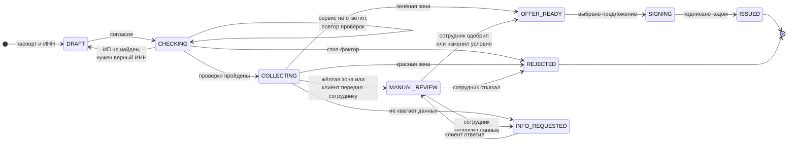

# Диаграмма состояний заявки

Заявка проходит 9 статусов. Статус хранит сервер, сайт только показывает его и следующее действие. Все переходы и тексты для клиента — `contract/statuses.md`. Любой другой переход сервер отклоняет (ошибка `INVALID_STATUS`).

| Статус | Что значит | Клиент видит | Следующее действие |
| --- | --- | --- | --- |
| `DRAFT` | Введены паспорт и ИНН | «Черновик заявки» | Дать согласие |
| `CHECKING` | Идут проверки | «Проверяем данные» | Ждать или повторить проверки |
| `COLLECTING` | Проверки пройдены, собираем данные | «Заполните заявку» | Выписка или анкета, цель, смета, отправка |
| `MANUAL_REVIEW` | Решает сотрудник | «Заявка у специалиста. Ответ до {дата}» | Ждать |
| `INFO_REQUESTED` | Нужны данные от клиента | «Нужно уточнение: {что}» | Ответить |
| `OFFER_READY` | Есть предложения | «Предложение готово» | Выбрать предложение |
| `SIGNING` | Подписание договора | «Подпишите договор» | Ввести код |
| `ISSUED` | Деньги выданы (смоделировано) | «Финансирование выдано» | — |
| `REJECTED` | Отказ | «Сейчас мы не можем одобрить заявку» + советы | — |

После выдачи статус не меняется: раннее предупреждение и рост лимита приходят как **уведомления**. Каждый переход записывается в историю заявки: время, старый и новый статус, кто (клиент, система, сотрудник), комментарий.
