# Статусы заявки

Статус хранит сервер. Сайт только показывает его и предлагает следующее действие (`nextAction` в ответе API).

## Список статусов

| Статус | Что значит | Текст для клиента | `nextAction` |
| --- | --- | --- | --- |
| `DRAFT` | Заявка создана, введены паспорт и ИНН | «Черновик заявки» | `GIVE_CONSENT` |
| `CHECKING` | Клиент дал согласие, идут проверки | «Проверяем данные» | `WAIT` или `RETRY_CHECKS` (если сервис не ответил) |
| `COLLECTING` | Проверки пройдены, собираем выписку, цель, смету | «Заполните заявку» | `UPLOAD_STATEMENT`, `SET_GOALS`, `REVIEW_ESTIMATE`, `SUBMIT` — по тому, чего не хватает |
| `MANUAL_REVIEW` | Заявку смотрит сотрудник | «Заявка у специалиста. Ответ до {дата}» | `WAIT` |
| `INFO_REQUESTED` | Нужны данные от клиента | «Нужно уточнение: {что именно}» | `ANSWER_INFO_REQUEST` |
| `OFFER_READY` | Есть предложение | «Предложение готово» | `CHOOSE_OFFER` |
| `SIGNING` | Клиент выбрал предложение, подписывает договор | «Подпишите договор» | `SIGN` |
| `ISSUED` | Договор подписан, деньги выданы (смоделировано) | «Финансирование выдано» | `NONE` |
| `REJECTED` | Отказ | «Сейчас мы не можем одобрить заявку» + советы | `NONE` |

Расчёт (смета → баллы → решение) после `submit` идёт сразу, без отдельного статуса: заявка из `COLLECTING` переходит в `OFFER_READY`, `MANUAL_REVIEW`, `INFO_REQUESTED` или `REJECTED`.

«Другие условия» — это не отдельный статус, а `OFFER_READY`, где у предложения `termsChanged: true` (сумма, срок или продукт отличаются от того, что просил клиент).

## Уточнения проверок

- `hasBusiness=false` + ЕГРИП `404 NOT_IP` при заполненном личном ИНН — нормальная проверка стартапа (`NONE`), не возврат в DRAFT. Остальные пять проверок выполняются.
- Паспорт `valid=false` с разрешённой причиной — `STOP`, из CHECKING в REJECTED. `valid=true, holderMatch=false/null` — `MANUAL`; остальные проверки продолжаются, затем заявка уходит на ручное рассмотрение **после submit**, не является автоотказом.
- Отсутствует личный ИНН при consent: 422 VALIDATION_ERROR, статус DRAFT не меняется. Публичного метода редактирования ИНН нет: клиент создаёт новую заявку, указав ИНН.
- Ошибка паспортной/другой заглушки (503 или тайм-аут) — остаётся CHECKING, nextAction RETRY_CHECKS; не подменять ошибку `MANUAL`.
- Отсутствует/недостоверна выписка, а данных недостаточно для риска — `INFO_REQUESTED` до рассмотрения либо `MANUAL_REVIEW` после отправки в зависимости от доступности подтверждения; подробные правила в mocks-contract.md.

## Повторная заявка

Открытая заявка — любая, кроме `ISSUED` и `REJECTED`. Если человек снова вводит паспорт и ИНН, а открытая заявка уже есть, сервер не создаёт новую и возвращает её (`POST /applications` → `200`). Совпадение — по ИНН, без ИНН — по серии и номеру паспорта.

## ИИ не понял цель

1. ИИ задаёт уточняющий вопрос. Сервер сам считает попытки: если после 2 сообщений клиента цель так и не определена (в `collected.goals` нет ни одной цели), сервер ставит `ESCALATED`, даже если ИИ этого не сделал.
2. При `ESCALATED` сайт показывает кнопки с готовыми целями, дальше — обычная форма.
3. Ни одна цель не подошла → кнопка «Передать сотруднику» → `POST /applications/{id}/handoff` → `MANUAL_REVIEW`. Статус заявки не меняется, пока клиент не нажал кнопку.

## Переходы

```
DRAFT ──consent──► CHECKING
CHECKING ──проверки ок──► COLLECTING
CHECKING ──стоп-фактор──► REJECTED
CHECKING ──hasBusiness=true, ИП не найден──► DRAFT (новая заявка с исправленным ИНН)
CHECKING ──hasBusiness=false, ЕГРИП NOT_IP, остальные проверки завершены без STOP──► COLLECTING
CHECKING ──сервис не ответил──► CHECKING (повтор: POST /checks)

COLLECTING ──submit──► OFFER_READY      (зелёная зона)
COLLECTING ──submit──► MANUAL_REVIEW    (жёлтая зона)
COLLECTING ──submit──► INFO_REQUESTED   (не хватает данных или не сходятся)
COLLECTING ──submit──► REJECTED         (красная зона)
COLLECTING ──handoff (цель не понята)──► MANUAL_REVIEW

MANUAL_REVIEW ──сотрудник APPROVE / CHANGE_TERMS──► OFFER_READY
MANUAL_REVIEW ──сотрудник REQUEST_INFO──► INFO_REQUESTED
MANUAL_REVIEW ──сотрудник REJECT──► REJECTED

INFO_REQUESTED ──клиент ответил──► MANUAL_REVIEW

OFFER_READY ──клиент выбрал предложение──► SIGNING
SIGNING ──верный код──► ISSUED
```

Любой другой переход сервер отклоняет с ошибкой `INVALID_STATUS` (HTTP 409).

## Диаграмма (Mermaid)

```mermaid
stateDiagram-v2
    [*] --> DRAFT
    DRAFT --> CHECKING: согласие
    CHECKING --> CHECKING: сервис не ответил, повтор
    CHECKING --> COLLECTING: проверки пройдены
    CHECKING --> REJECTED: стоп-фактор
    CHECKING --> DRAFT: hasBusiness=true, ИП не найден
    CHECKING --> COLLECTING: hasBusiness=false, NOT_IP; остальные проверки пройдены
    COLLECTING --> OFFER_READY: зелёная зона
    COLLECTING --> MANUAL_REVIEW: жёлтая зона
    COLLECTING --> INFO_REQUESTED: нужны данные
    COLLECTING --> REJECTED: красная зона
    COLLECTING --> MANUAL_REVIEW: клиент передал сотруднику
    MANUAL_REVIEW --> OFFER_READY: одобрить / изменить условия
    MANUAL_REVIEW --> INFO_REQUESTED: запросить данные
    MANUAL_REVIEW --> REJECTED: отказать
    INFO_REQUESTED --> MANUAL_REVIEW: клиент ответил
    OFFER_READY --> SIGNING: выбрано предложение
    SIGNING --> ISSUED: подписано кодом
    ISSUED --> [*]
    REJECTED --> [*]
```



## История

Каждый переход сервер записывает в историю заявки: время, старый и новый статус, кто (`CLIENT`, `SYSTEM`, `STAFF`), комментарий. История видна в кабинете сотрудника (`history` в карточке).

## После выдачи

Статус остаётся `ISSUED`. Раннее предупреждение и рост лимита приходят как **уведомления** (`/notifications`), а не как смена статуса.
